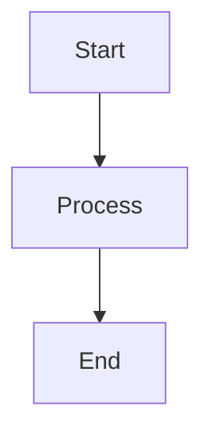

# HyperFleet Architecture Repository

Documentation-only repository. Single source of truth for all HyperFleet architectural documentation. No application code.

## Setup

```bash
make install-hooks    # Install pre-commit hooks (secret scanning, commit message validation)
```

## Validation

| Script | Checks |
|--------|--------|
| `./hack/markdownlint.sh` | Markdown formatting |
| `./hack/yamllint.sh` | YAML formatting |
| `./hack/linkcheck.sh` | Internal links |

Only MD013 (line length) and MD060 (table column style) are disabled — see `.markdownlint-cli2.yaml` for the full config.

## Source of Truth

| Topic | Location |
|-------|----------|
| System architecture overview | `hyperfleet/README.md` |
| Component design docs | `hyperfleet/components/` |
| Component doc requirements | [hyperfleet/components/](#hyperfleetcomponents) below |
| Engineering standards | `hyperfleet/standards/` |
| Standards doc requirements | [hyperfleet/standards/](#hyperfleetstandards) below |
| Implementation guides | `hyperfleet/docs/` |
| Architecture Decision Records | `hyperfleet/adrs/` (see `hyperfleet/adrs/README.md` for template) |
| Glossary / terminology | `hyperfleet/docs/glossary.md` |
| Document templates | `hyperfleet/docs/templates/` |
| Deprecated / archived docs | `hyperfleet/deprecated/` |

## Document Rules

### Metadata Header

Every document starts with:

```markdown
---
Status: Active
Owner: Team Name
Last Updated: YYYY-MM-DD
---
```

Update "Last Updated" only for meaningful changes (design decisions, new sections, trade-offs modified) — not typos or formatting.

### Status Filtering

**IMPORTANT:** Unless explicitly asked otherwise, ignore any document with Status other than `Active` or located under a `deprecated/` directory.

### Required Sections by Document Type

Component docs (`hyperfleet/components/`): MUST include Trade-offs AND Alternatives Considered sections. See [hyperfleet/components/](#hyperfleetcomponents) below for the full template and required section list.

Standards docs (`hyperfleet/standards/`): MUST follow Overview, Standard, Examples, Enforcement, References pattern with RFC 2119 language. See [hyperfleet/standards/](#hyperfleetstandards) below for full details.

### Diagrams

Use Mermaid syntax for new diagrams. Avoid adding image files; some legacy images exist.

### Writing Quality

Quantify architectural claims. See `README.md` Writing Guidelines for examples.

### Glossary

**IMPORTANT:** Before introducing new terms, check `hyperfleet/docs/glossary.md`. Add new terms in the same change.

## Gotchas

- Markdownlint is strict — only MD013 (line length) and MD060 (table column style) are disabled in `.markdownlint-cli2.yaml`. Linting is enforced in CI.
- Legacy PNG images exist in the repo despite Mermaid-first policy. Don't flag or delete them.
- Trade-offs, Alternatives Considered, and metadata header requirements are prompt-only — no mechanical validator exists yet. Easy to miss.

## Boundaries

### DO NOT

1. **Create code files** — documentation only, no exceptions
2. **Skip Trade-offs or Alternatives Considered** in component docs
3. **Create docs without metadata header** (`Status`, `Owner`, `Last Updated`)
4. **Use vague language** — quantify impact, be specific
5. **Put documents in wrong directories** — check Source of Truth table above
6. **Surface deprecated documents** unless explicitly asked

### DO

1. Read existing docs in target directory before creating new ones
2. Check glossary before introducing new terms
3. Use `hyperfleet/components/sentinel/sentinel.md` as reference example for component docs
4. Validate changes with `./hack/markdownlint.sh` and `./hack/yamllint.sh`

## hyperfleet/components/

### What Component Documents Are

Component documents are **DESIGN documents** - they describe architectural decisions for individual components. Unlike standards, they are not prescriptive rules but rather documentation of how specific components work and why.

### REQUIRED Sections

Every component document MUST include these sections. **DO NOT SKIP ANY.**

#### 1. What & Why

```markdown
## What & Why

**What**: Component purpose and responsibilities

**Why**: Problem it solves, context, what happens without it
```

#### 2. How (with Mermaid diagrams)

````markdown
## How

[Technical implementation approach]


````

#### 3. Trade-offs (DO NOT SKIP)

**This section is MANDATORY.** Every design involves trade-offs. Document them honestly.

```markdown
## Trade-offs

### What We Gain
- ✅ Benefit with measurable impact
- ✅ Another benefit with context

### What We Lose / What Gets Harder
- ❌ Cost - Technical debt we're accepting
- ❌ Capability we're giving up
- ⚠️ Risk - What could go wrong

### Technical Debt Incurred
- **Debt Item**: Description, impact, remediation plan

### Acceptable Because
- Reason why the trade-off makes sense for MVP/timeline/scope
```

#### 4. Alternatives Considered (DO NOT SKIP)

**This section is MANDATORY.** Trade-offs only make sense when compared to alternatives.

```markdown
## Alternatives Considered

### [Alternative Name]
**What**: Brief description of the alternative approach
**Why Rejected**: Specific reason why this wasn't chosen
```

### Component Subdirectories

Components are organized by type:

| Directory | Purpose |
|-----------|---------|
| `hyperfleet/components/adapter/` | Adapter implementations (validation, cloud providers, etc.) |
| `hyperfleet/components/api-service/` | HyperFleet API service design |
| `hyperfleet/components/broker/` | Message broker architecture |
| `hyperfleet/components/sentinel/` | Sentinel reconciliation service |

### Quantification Guidelines

Be specific, not vague:

| Bad | Good |
|-----|------|
| "Faster" | "Reduces latency from 200ms to 50ms" |
| "More scalable" | "Supports 10x more concurrent requests" |
| "Simpler" | "Reduces components from 6 to 5" |
| "Better" | "Eliminates single point of failure" |

### Status Reporting Pattern

When documenting component status fields, use this pattern:

```markdown
### Status Conditions

| Condition | Meaning |
|-----------|---------|
| Available | Component is deployed and reachable |
| Applied | Desired state has been reconciled |
| Health | Component is operating normally |
```

### Updating Existing Documents

When updating component docs:

1. Read the existing document first
2. Update relevant sections
3. Update "Last Updated" date for meaningful changes
4. If paying down technical debt, strikethrough the item and link to PR:

```markdown
- ~~**No retry logic**: Adapters don't retry failed operations~~
  - **Status**: Resolved in #123
```

### Example: Component Document

See `hyperfleet/components/sentinel/sentinel.md` for an example with:

- Clear What & Why section
- Detailed How section with diagrams
- Test scenarios documented

**Note**: sentinel.md now includes Trade-offs and Alternatives Considered sections and can be used as a reference for the full component document pattern.

### Common Mistakes to Avoid

1. **Skipping Trade-offs** - "This is clearly better" is not acceptable
2. **Skipping Alternatives** - "This was obvious" is not acceptable
3. **Vague benefits** - Quantify or explain specifically
4. **Missing diagrams** - All components need at least one Mermaid diagram
5. **Forgetting dependencies** - Document what the component relies on
6. **Missing configuration** - Consider documenting how to configure the component (if applicable)

## hyperfleet/standards/

### What Standards Are

Standards are **PRESCRIPTIVE** - they define rules that MUST be followed across all HyperFleet repositories. They are not suggestions or design documents.

### Standard Document Pattern

Every standard follows this structure:

1. **Overview** - What this standard covers and why it matters
2. **Standard** - The actual requirements (MUST/SHOULD/MAY)
3. **Examples** - Good and bad examples showing compliance
4. **Enforcement** - How the standard is checked (CI, linting, review)
5. **References** - Links to external docs or related standards

### Existing Standards

Reference these when working with standards (non-exhaustive - see `hyperfleet/standards/` for full list). All paths in this table are relative to `hyperfleet/standards/`:

| Standard | Purpose |
|----------|---------|
| `commit-standard.md` | Commit message format (Conventional Commits + JIRA prefix) |
| `configuration.md` | Configuration management |
| `container-image-standard.md` | Container image requirements |
| `dependency-pinning.md` | Dependency version pinning |
| `directory-structure.md` | Repository structure |
| `error-model.md` | Error handling patterns |
| `generated-code-policy.md` | Generated code management |
| `graceful-shutdown.md` | Shutdown signal handling |
| `health-endpoints.md` | Health check endpoints |
| `helm-chart-conventions.md` | Helm chart structure and conventions |
| `linting.md` | Linting requirements |
| `logging-specification.md` | Logging: `log/slog` with the shared `hyperfleet-logger` handler, fields, levels |
| `makefile-conventions.md` | Makefile patterns |
| `metrics.md` | Prometheus metrics |
| `ticket-hygiene.md` | JIRA ticket field requirements and sprint readiness |
| `tracing.md` | Distributed tracing |
| `code-review/README.md` | Code review standards index and severity principle |
| `code-review/error-handling.md` | Code review: error checking, wrapping, HTTP handler returns (Go) |
| `code-review/concurrency.md` | Code review: shared state, goroutine lifecycle, loop capture (Go) |
| `code-review/exhaustiveness.md` | Code review: switch/select completeness, nil/bounds guards (Go) |
| `code-review/resource-lifecycle.md` | Code review: resource cleanup, context propagation, timers (Go) |
| `code-review/code-quality.md` | Code review: constants, struct init, function complexity (Go) |
| `code-review/testing.md` | Code review: test coverage, structure, isolation (Go) |
| `code-review/naming.md` | Code review: Go naming conventions (stuttering, acronyms, getters) |
| `code-review/performance.md` | Code review: preallocation, defer in loops, N+1 queries (Go) |
| `code-review/security.md` | Code review: injection, secrets, path traversal (all languages) |
| `code-review/code-hygiene.md` | Code review: TODOs, log levels, typos (all languages) |

### RFC 2119 Language

Use these keywords with their RFC 2119 meanings:

- **MUST** / **REQUIRED** - Absolute requirement
- **MUST NOT** - Absolute prohibition
- **SHOULD** / **RECOMMENDED** - Strong recommendation with valid exceptions
- **SHOULD NOT** - Strong recommendation against with valid exceptions
- **MAY** / **OPTIONAL** - Truly optional

Example:

```markdown
Services MUST expose a `/healthz` endpoint.
Services SHOULD use structured JSON logging.
Services MAY implement custom metrics beyond the required set.
```

### Adding New Standards Checklist

When creating a new standard:

- [ ] Follows the document pattern (Overview, Standard, Examples, Enforcement, References)
- [ ] Uses RFC 2119 language correctly
- [ ] Includes both good and bad examples
- [ ] Defines how it will be enforced
- [ ] Has proper header (Status, Owner, Last Updated)
- [ ] Links to related standards if applicable

### Common Patterns

#### Requirement Tables

```markdown
| Requirement | Level | Notes |
|-------------|-------|-------|
| Health endpoint | MUST | Required for k8s probes |
| Metrics endpoint | MUST | Required for monitoring |
| Tracing headers | SHOULD | Recommended for debugging |
```

#### Good/Bad Examples

````markdown
### Good Example
```go
// Structured logging with context
slog.InfoContext(ctx, "request processed", "duration", duration, "status", status)
```

### Bad Example
```go
// Unstructured logging
fmt.Printf("processed request in %v\n", duration)
```
````

#### Code Blocks

Always specify the language for syntax highlighting:

- `go` for Go code
- `yaml` for YAML configuration
- `bash` for shell commands
- `json` for JSON examples

### Tone and Voice

- Be direct and authoritative
- State requirements clearly
- Avoid hedging language ("maybe", "perhaps", "might want to")
- Explain the "why" briefly, focus on the "what"
