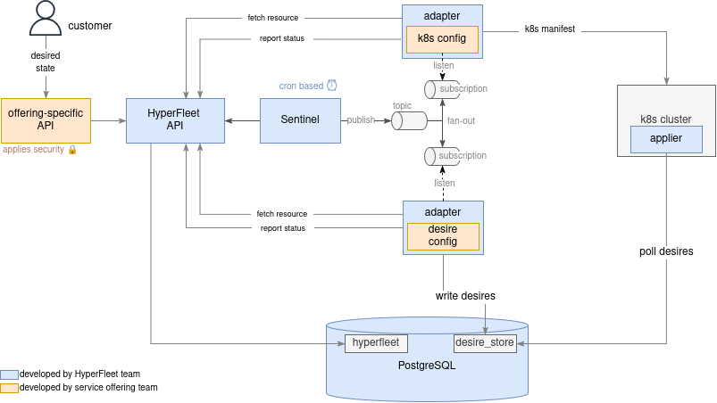

# HyperFleet Architecture

## Overview

HyperFleet is a scalable, event-driven system for managing OpenShift cluster lifecycle operations in a "provider-agnostic" way. It provides an API to manage customer requests for different resources (clusters, nodepools...) and orchestrates tasks that reconcile that state. These tasks which are provider-specific are outside of HyperFleet itself, which acts as a kind of "distributed kubernetes controller" with pluggable reconcilers. The architecture follows a separation of concerns pattern with distinct components for data storage, orchestration, and execution.

**Core components**:

- API layer managing desired state for resources (clusters, nodepools)
- Sentinel watching state changes and triggering asynchronous work
- Adapters executing the provider-specific provisioning tasks and reporting status

---

## Architecture Diagram

The following diagram shows the different components of HyperFleet (in blue) and how they interact with other components in the greater system.



(Note: the previous PNG image can be imported in draw.io for editing)

---

## HyperFleet Components

### HyperFleet API

Simple REST API providing CRUD operations for cluster and node pool resources.

- **Responsibilities**: Resource persistence, status ingestion, data retrieval
- **Stack**: Go, PostgreSQL, OpenAPI-driven
- **Design**: Stateless, no complex business logic, horizontally scalable

The HyperFleet API sits behind a service-offering API that:

- Contain specific security based on the cloud provider it is deployed
- Validates service-offering specific schema contract
- Exposes the system externally

**See**: [components/api-service](./components/api-service/) for detailed documentation

**Repository**: [hyperfleet-api](https://github.com/openshift-hyperfleet/hyperfleet-api)

**API Specification**: [hyperfleet-api-spec](https://github.com/openshift-hyperfleet/hyperfleet-api-spec)

---

### Database (PostgreSQL)

Persistent storage for cluster resources, node pools, and adapter status updates.

- **Purpose**: Single source of truth for all cluster state
- **Features**: JSONB storage for flexible schemas, status history, label-based filtering

---

### Sentinel

Service that polls the HyperFleet API, evaluates when resources need reconciliation using CEL-based decision logic, and publishes CloudEvents to the message broker.

- **Responsibilities**: Resource monitoring, decision logic execution, event publishing
- **Stack**: Go, CEL (Common Expression Language), CloudEvents
- **Features**: Configurable polling, horizontal sharding via label selectors, pluggable broker support

**See**: [components/sentinel](./components/sentinel/) for detailed documentation

**Repository**: [hyperfleet-sentinel](https://github.com/openshift-hyperfleet/hyperfleet-sentinel)

---

### Message Broker

Message broker implementing fan-out pattern to distribute reconciliation events to multiple adapters.

- **Supported Brokers**: GCP Pub/Sub, RabbitMQ
- **Pattern**: Topic-based fan-out with subscription per adapter
- **Event Format**: CloudEvents 1.0

**See**: [components/broker](./components/broker/) for detailed documentation

---

### Adapter Deployments

Event-driven services that consume reconciliation events, evaluate preconditions, create Kubernetes Jobs, and report status back to the HyperFleet API.

- **Responsibilities**: Event consumption, precondition evaluation, job creation, status reporting
- **Stack**: Go, Kubernetes client-go, CloudEvents
- **Features**: Config-driven preconditions, Kubernetes transport layers, idempotent operations

**Adapter Types** (MVP):

- Landing Zone Adapter - Namespace/secret/configmap preparation
- Validation Adapter - Quota/networking/policy validation
- DNS Adapter - DNS records and certificates
- Placement Adapter - Infrastructure placement selection
- Pull Secret Adapter - Image pull secret management
- Control Plane Adapter - HyperShift control plane creation
- Node Pool Validation Adapter - Node pool prerequisite validation
- Node Pool Adapter - HyperShift node pool creation

**See**: [components/adapter](./components/adapter/) for detailed documentation

**Repository**: [hyperfleet-adapter](https://github.com/openshift-hyperfleet/hyperfleet-adapter)

---

### Kubernetes Resources

Kubernetes resources (Jobs, Secrets, ConfigMaps, Services) created by adapters to execute provisioning tasks.

- **Pattern**: Long-running operations execute as Jobs, not in adapter pods
- **Benefits**: Isolation, observability, resource management, declarative cleanup

---

## Related Repositories

- [hyperfleet-api-spec](https://github.com/openshift-hyperfleet/hyperfleet-api-spec) - TypeSpec-based OpenAPI contract generator
- [hyperfleet-api](https://github.com/openshift-hyperfleet/hyperfleet-api) - REST API implementation
- [hyperfleet-sentinel](https://github.com/openshift-hyperfleet/hyperfleet-sentinel) - Orchestration and decision engine
- [hyperfleet-adapter](https://github.com/openshift-hyperfleet/hyperfleet-adapter) - Adapter framework implementation
- [hyperfleet-infra](https://github.com/openshift-hyperfleet/hyperfleet-infra) - Infrastructure as Code (Terraform + Helm)
- [hyperfleet-e2e](https://github.com/openshift-hyperfleet/hyperfleet-e2e) - End-to-end testing framework

---

## Data Flow

### Cluster Creation Flow

```text
1. User → POST /clusters → API → PostgreSQL
2. Sentinel polls API → Evaluates decision logic
3. Sentinel publishes CloudEvent → Message Broker
4. Broker fan-out → Multiple Adapters
5. Each Adapter:
   - Fetches cluster details from API
   - Evaluates preconditions
   - Creates Kubernetes resources if conditions met
   - Reports status → PUT /clusters/{id}/statuses
6. API aggregates adapter statuses → Updates cluster status
7. Cycle repeats until cluster reaches Reconciled state
```

---

## Key Design Benefits

- **Reduced Complexity**: Simple CRUD API with no complex business logic
- **Lower Latency**: Direct event publishing from Sentinel to broker
- **Separation of Concerns**: API = data, Sentinel = orchestration, Adapters = execution
- **Easier Testing**: Components testable in isolation with clear interfaces
- **Improved Observability**: Centralized decision logic and metrics
- **Horizontal Scalability**: Stateless components scale independently
- **Kubernetes-native Status**: Condition-based status model for multi-dimensional state

---

## Additional Documentation

- [Component Details](./components/) - In-depth documentation for each component
- [ADRs](./adrs/) - Architecture Decision Records
- [Docs](./docs/) - Additional guides and standards
