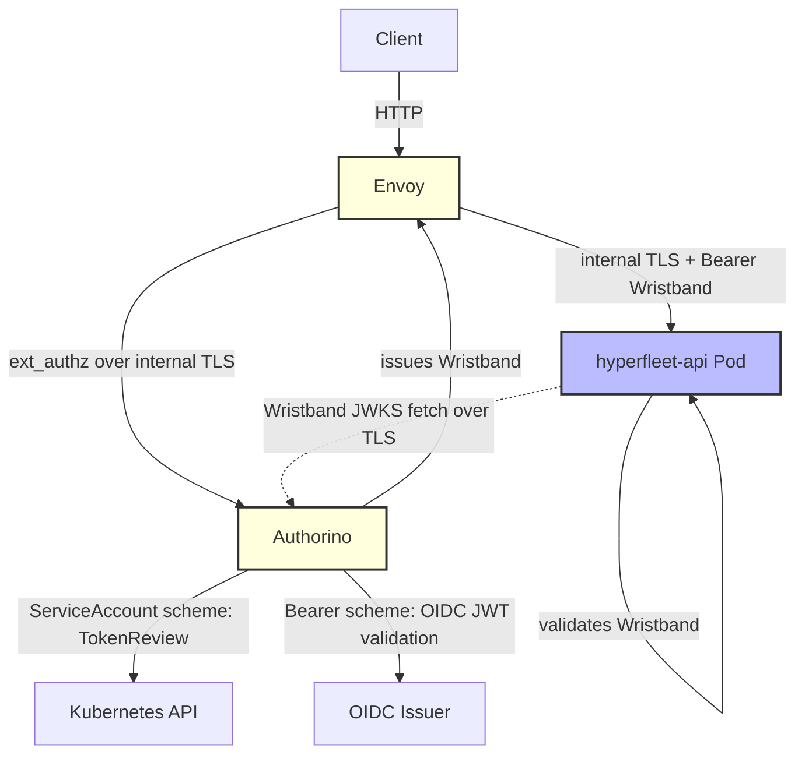
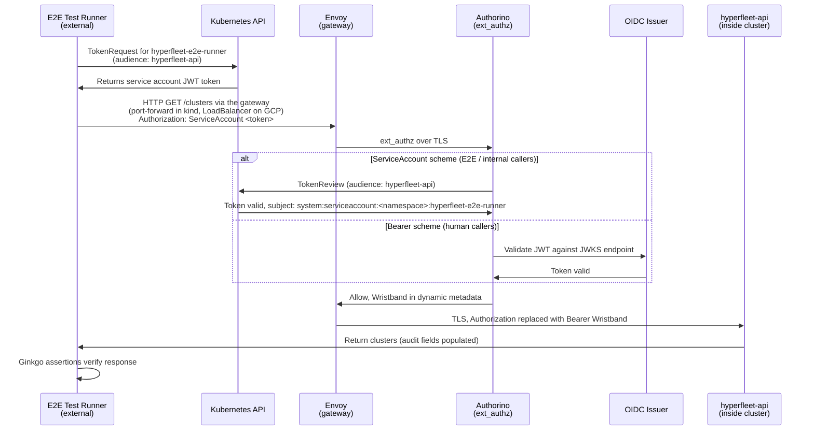

# 0018 — E2E JWT/TLS Architecture

## Context

The E2E test framework ([hyperfleet-e2e](https://gitlab.cee.redhat.com/service/hyperfleet/hyperfleet-e2e)) currently runs without JWT/TLS (development mode), creating a gap between test and production environments. Before implementing security in E2E tests, critical architectural questions were answered to ensure the correct approach and avoid wasted effort.

**Key Decision Point from Office Hours (2026-07-01)**: The team agreed to define a **cloud-agnostic contract** for TLS and JWT handling to avoid relying on specific cloud provider behaviors (GCP, AWS, Azure, OCI).

Today Envoy receives plain HTTP on port 8000, and no component in front of it terminates TLS. The target architecture adds TLS termination at the ingress / cloud load balancer. That hop is planned and not yet implemented:

This means:

- Planned: the ingress / cloud load balancer terminates TLS and forwards HTTP to Envoy. Today clients send HTTP directly to Envoy
- Envoy receives HTTP, then uses internal TLS to Authorino and the API (namespace-local cert-manager CA)
- The Envoy + Authorino gateway validates JWT tokens for authentication (see [ADR-0020](0020-envoy-authorino-api-gateway.md))

## Decision

**E2E tests will use Kubernetes service account tokens for authentication:**

1. **No application-level TLS testing** — E2E tests connect via HTTP to the Envoy gateway, the protocol Envoy receives today; ingress TLS termination is planned and out of scope
2. **Use Kubernetes Service Account Tokens for JWT authentication** — Ginkgo tests run **outside the cluster** (developer laptops / CI runners) and request service account tokens through the Kubernetes TokenRequest API with `audience: hyperfleet-api`
3. **Test the gateway + API authentication contract** — E2E tests route through the Envoy gateway and send the scheme their deployment's `AUTH_MODE` requires; `AUTH_MODE` is the hyperfleet-infra setting that selects where authentication runs ([ADR-0020](0020-envoy-authorino-api-gateway.md) defines the modes). TLS/certificate handling is out of scope.

### Implementation Details

**Test Execution Model:**

Ginkgo E2E tests run **outside the Kubernetes cluster** (developer laptops / CI runners). Only infrastructure components (API, Sentinel, Adapters) run as pods inside the test namespace.

**Token Generation:**

At suite start, the E2E framework calls the TokenRequest API for the `hyperfleet-e2e-runner` ServiceAccount (audience `hyperfleet-api`, 7200 s). In `e2e-kind` and `e2e-gcp`, hyperfleet-infra creates that ServiceAccount and adds it to the gateway allow-list. The runner never uses the `default` ServiceAccount.

**Note:** Infrastructure pods (Sentinel/Adapters) use projected service account token volumes as documented in their component designs. E2E tests call TokenRequest because they run externally.

**API Configuration** — Primary token validation is performed by Authorino at the gateway. In `EDGE+API`, the API validates only the Wristband ([ADR-0020](0020-envoy-authorino-api-gateway.md)) as defense-in-depth; its `sub` is `system:serviceaccount:<namespace>:hyperfleet-e2e-runner`. In `API` mode, the API validates the Kubernetes ServiceAccount token directly.

**Test Flow:**

**E2E Client Changes** (in [hyperfleet-e2e](https://gitlab.cee.redhat.com/service/hyperfleet/hyperfleet-e2e) repository):

The runner reads `auth_mode` (default `EDGE+API`, overridden by `AUTH_MODE`); it must match the deployed mode.

| `AUTH_MODE` | E2E client | Test adapters |
|-------------|------------|---------------|
| `NONE` | No token | No token (auth disabled) |
| `API` | `Bearer <token>` | `Bearer <token>` |
| `EDGE` | `ServiceAccount <token>` | `ServiceAccount <token>` |
| `EDGE+API` | `ServiceAccount <token>` | `ServiceAccount <token>` |

**Test Coverage:**

- ✅ Gateway authentication through TokenReview, selected by the `ServiceAccount` scheme
- ✅ In `EDGE+API`, the API receives an Authorino Wristband instead of the client token
- ✅ In `EDGE+API`, caller identity comes from the Wristband `sub`
- ✅ Audit fields populated correctly (`created_by`, `updated_by`, `deleted_by`) using the validated caller identity - see [v1.0.0 Upgrade Guide §1.4](../docs/release/v0.2.0-to-v1.0.0-upgrade-guide.md#14-jwt-identity-claim-for-audit-fields) for JWT identity claim mapping
- ✅ In `EDGE` and `EDGE+API`, 401/403 responses for invalid/missing tokens are returned by the gateway before reaching the API. In `API`, the API returns them.
- ✅ Token expiration configuration (TokenRequest lifetime)
- ❌ Ingress TLS termination (planned, not deployed; out of scope)
- ❌ Certificate validation (infrastructure responsibility, out of scope)
- ❌ External user OIDC authentication, header stripping, and tenant isolation (hyperfleet-infra gateway E2E suite)

## Consequences

**Gains:**

- ✅ **Kubernetes-native** — Uses the built-in TokenRequest API
- ✅ **Real JWT validation** — Tests validate actual Kubernetes-signed tokens, not mocks
- ✅ **Ephemeral tokens** — Generated on demand, not stored in cluster
- ✅ **Minimal infrastructure** — No pods for token extraction; in `EDGE` and `EDGE+API`, Envoy and Authorino are required as the auth gateway. The machine-token path needs no OIDC server; the e2e mock issuer serves only the human provider
- ✅ **Cloud-agnostic** — Works in any Kubernetes cluster with the TokenRequest API (GKE, EKS, AKS, kind)
- ✅ **Fast** — Token generation in ~100ms vs ~5-10s for Job-based approaches

**Trade-offs:**

- ⚠️ **Service-to-service auth only** — Tests validate service account authentication, not external user OIDC flows
- ⚠️ **Service account identity format** — Audit fields show `system:serviceaccount:namespace:sa-name` instead of user emails
- ⚠️ **No TLS testing** — Ingress TLS termination is out of scope for E2E tests and not deployed yet
- ⚠️ **Mode coupling** — E2E `AUTH_MODE` must match the deployed mode; otherwise the wrong scheme fails authentication

## Alternatives Considered

| Alternative | Why Rejected |
|-------------|--------------|
| **Job-based token extraction** | ❌ Requires deploying Job pod, waiting ~5-10s, writing to annotation. A direct TokenRequest call achieves the same result in ~100ms with zero resources. |
| **Mock OIDC server for machine tokens** | ❌ Unnecessary infrastructure. Kubernetes provides native JWT authentication via service account tokens. |
| **GCP Identity Tokens** | ❌ Violates cloud-agnostic principle. Cannot run locally or in AWS/Azure CI/CD. |
| **Application-level TLS** | ❌ Envoy receives HTTP today; planned ingress TLS termination sits outside the gateway. Would test behavior not deployed. |
| **Skip JWT testing** | ❌ Leaves gap in authentication contract testing. Audit fields wouldn't be validated. |
| **External OIDC (Keycloak, Dex)** | ❌ Adds operational complexity. Service account tokens are simpler and Kubernetes-native. |

---

## References

- **JIRA Tickets**:
  - [HYPERFLEET-1235](https://redhat.atlassian.net/browse/HYPERFLEET-1235) — Investigation and ADR creation
  - [HYPERFLEET-1342](https://redhat.atlassian.net/browse/HYPERFLEET-1342) — Original `kubectl create token` approach (superseded)
  - [HYPERFLEET-1484](https://redhat.atlassian.net/browse/HYPERFLEET-1484) — `EDGE+API` default, runner identity, mode-aware schemes
  - [HYPERFLEET-1146](https://redhat.atlassian.net/browse/HYPERFLEET-1146) — Original E2E security gap identification
- **External Resources**:
  - [Kubernetes TokenRequest API](https://kubernetes.io/docs/reference/kubernetes-api/authentication-resources/token-request-v1/) — JWT generation and validation mechanism
  - [Kubernetes Service Account Token Projection](https://kubernetes.io/docs/tasks/configure-pod-container/configure-service-account/#serviceaccount-token-volume-projection) — How infrastructure pods (Sentinel/Adapters) mount tokens
  - [RFC 7519 - JWT](https://datatracker.ietf.org/doc/html/rfc7519) — JWT specification
