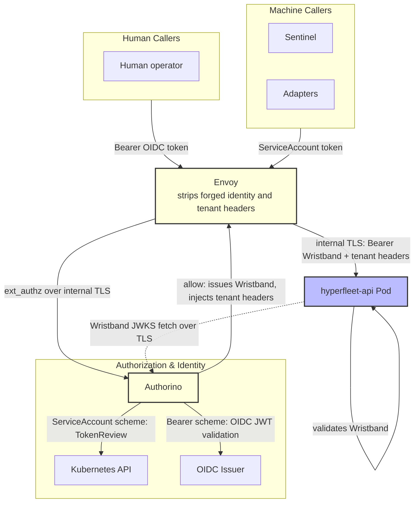

# 0020 - Envoy and Authorino as the API Authentication Gateway

## Context

HyperFleet's API is accessed by two caller types: external callers (human operators) authenticating with OIDC JWTs, and internal callers (Sentinel and Adapters) using Kubernetes projected service account tokens. Before this decision, each component validated credentials independently in application code.

Three structural problems drove the change:

1. **No single audit point.** External and internal traffic had no canonical interception point; a client-supplied identity header could reach application logic unchallenged.
2. **Identity configuration lived in application code.** Switching tenant models required rebuilding and redeploying the API.
3. **No enforceable network boundary.** Nothing prevented an in-cluster workload from reaching the API pod directly, bypassing any authentication layer.

A [proof-of-concept](https://github.com/ciaranRoche/hyperfleet-infra/tree/poc/multitenancy-v2) validated the approach. The architecture team reviewed the results and made the decision.

## Decision

HyperFleet adopts **Envoy** as the API ingress proxy and **Authorino** as its external authorization service. All API traffic, external and internal, passes through Envoy. No other route to the API is permitted.

### Authentication Modes

Each deployment selects where authentication runs:

| Mode | Gateway (Envoy + Authorino) | API |
|------|-----------------------------|-----|
| `NONE` | No authentication | No authentication (development only) |
| `API` | Routes only; Authorino absent | Validates the caller's token |
| `EDGE` | Authenticates every caller | No token validation; trusts the gateway |
| `EDGE+API` | Authenticates every caller, then issues a Wristband | Validates the Wristband (defense in depth) |

`make`-driven deployments default to `EDGE+API`; Helmfile alone defaults to `NONE`.

A **Wristband** is a short-lived token that only Authorino can sign. The implementation must provide:

- **Scheme selection.** `Authorization: ServiceAccount <token>` selects Kubernetes TokenReview for internal callers; `Authorization: Bearer <token>` selects OIDC for human callers. Missing or unknown schemes are denied.
- **Credential exchange in `EDGE+API`.** The gateway replaces the client credential with the Wristband before forwarding, and rejects the request if no Wristband was issued.
- **API identity in `EDGE+API`.** The API trusts one issuer, Authorino, and takes caller identity from the Wristband subject. It never uses the client credential or a gateway identity header as identity.

### Gateway Contract

- **Early header stripping.** Envoy removes client-supplied identity and tenant headers before the authorization filter runs, so forged headers cannot reach Authorino or the API regardless of what the client sends.
- **Authorino authenticates every caller via AuthConfig CRs in `EDGE` and `EDGE+API`.** External callers are validated against an OIDC issuer. Internal callers (Sentinel, Adapters) are validated via Kubernetes TokenReview against a subject allowlist; an in-cluster service account with the correct audience but an unlisted subject is denied at the gateway. Identity providers, claim mappings, and per-deployment tenant models are declared in AuthConfig custom resources (not application code) so switching a tenant model is a configuration change with no rebuild required.
- **Tenant header injection in `EDGE` and `EDGE+API`.** After successful authorization, Authorino injects tenant and system headers derived from validated claims. Tenant enforcement uses them; they are not caller identity.
- **Internal TLS.** Gateway hops (Envoy to Authorino, Envoy to API, and the API fetching Wristband keys from Authorino) use TLS from a namespace-local CA. Server TLS only; no mTLS.
- **Network boundary is a security requirement.** A NetworkPolicy restricts API pod ingress to the Envoy pod only. The gateway is not an optional optimization; bypassing it must be structurally impossible, not merely discouraged.

Current request path (<code>EDGE+API</code>)

## Consequences

**Gains:**

- One audit point for all API traffic, internal and external, without per-component authentication logic.
- Adding an identity provider or switching a tenant model is an AuthConfig change (no code change, no rebuild, no redeployment of any HyperFleet component).
- Forged identity headers are stripped before any application logic runs.
- The network boundary is enforceable and testable.

**Trade-offs:**

- The gateway is on the availability path of every API call, including internal Sentinel and Adapter traffic. A highly available deployment with health checks is required from day one. A gateway outage is a full API outage.
- Header stripping must happen at an early filter stage, before the authorization filter runs. Using a later removal mechanism would delete the headers Authorino injects. This ordering constraint is non-obvious and must be guarded by a test.
- All internal services must route API traffic through Envoy. Pointing directly at the API service bypasses authentication and is rejected. Helm charts for Sentinel and Adapters must expose and correctly default the API base URL, and use the `ServiceAccount` scheme in `EDGE` and `EDGE+API`.
- `EDGE+API` adds Wristband signing and validation to every request, and the API depends on Authorino for Wristband keys.
- Wristband signing-key and CA rotation complexity, to be solved by ([HYPERFLEET-1523](https://redhat.atlassian.net/browse/HYPERFLEET-1523)).

## Alternatives Considered

| Alternative | Why Rejected |
|-------------|--------------|
| **Application-only middleware** | No shared audit point; identity config changes require rebuilds across every component; no enforceable network boundary. |
| **Per-service sidecar (service mesh)** | Does not provide a single ingress point for external callers. Sidecars can be layered on later without changing the trust model established here. |
| **OPA (Open Policy Agent)** | Policy engine, not an authentication service. Does not validate OIDC JWTs or perform TokenReview; a separate validation layer would be required alongside it. Authorino covers both in one CR-driven model. |
| **No shared boundary** | Per-component credential validation; no canonical audit point; identity config embedded in application deployments. Incompatible with the multi-tenant model where header provenance must be guaranteed. |

---

## References

- **POC:** [`poc/multitenancy-v2` branch of `hyperfleet-infra`](https://github.com/ciaranRoche/hyperfleet-infra/tree/poc/multitenancy-v2)
- **Epic:** [Envoy and Authorino Gateway Deployment](https://redhat.atlassian.net/browse/HYPERFLEET-1476)
- **Implementation:** [HYPERFLEET-1648](https://redhat.atlassian.net/browse/HYPERFLEET-1648) (internal CA and TLS), [HYPERFLEET-1668](https://redhat.atlassian.net/browse/HYPERFLEET-1668) (Wristband and `AUTH_MODE`), [HYPERFLEET-1484](https://redhat.atlassian.net/browse/HYPERFLEET-1484) (`EDGE+API` default), [HYPERFLEET-1523](https://redhat.atlassian.net/browse/HYPERFLEET-1523) (rotation spike, open)
- **Sibling epic:** [Multi-Tenant Identity and Authorization](https://redhat.atlassian.net/browse/HYPERFLEET-1164)
- **External resources:**
  - [Envoy proxy documentation](https://www.envoyproxy.io/docs/envoy/latest/)
  - [Authorino documentation](https://github.com/Kuadrant/authorino)
  - [Kubernetes TokenReview API](https://kubernetes.io/docs/reference/kubernetes-api/authentication-resources/token-review-v1/)
