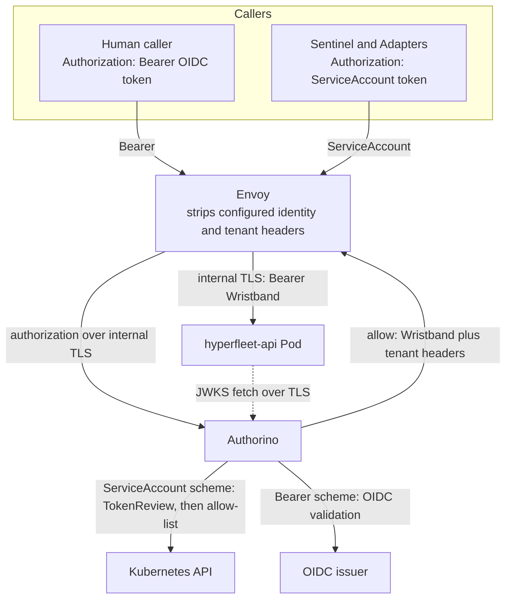
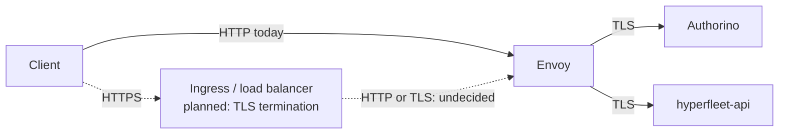

# Gateway Authentication Design

**Jira**: [HYPERFLEET-1636](https://redhat.atlassian.net/browse/HYPERFLEET-1636)

**Implements**: [ADR-0020: Envoy and Authorino as the API Authentication Gateway](../adrs/0020-envoy-authorino-api-gateway.md)

**Related**: [ADR-0018: E2E JWT/TLS Architecture](../adrs/0018-e2e-jwt-tls-architecture.md), [ADR-0029: Desire Store Authorization](../adrs/0029-desire-store-authorization.md), [Multi-Tenant Identity and Authorization Design](multi-tenant-identity-authz-design.md)

## Table of Contents

- [Problem Statement](#problem-statement)
- [How](#how)
  - [Authentication modes](#authentication-modes)
  - [Scheme selection](#scheme-selection)
  - [Request path](#request-path)
  - [Wristband](#wristband)
  - [Internal TLS](#internal-tls)
  - [E2E client contract](#e2e-client-contract)
- [Design Trade-offs](#design-trade-offs)
- [Alternatives](#alternatives)
- [References](#references)

## Problem Statement

[ADR-0020](../adrs/0020-envoy-authorino-api-gateway.md) establishes Envoy and Authorino as the API authentication gateway. In `EDGE+API`, the gateway exchanges the client credential for an Authorino Wristband.

This document describes the authentication flow, trust boundaries, deployment risks, and E2E client contract. Implementation details are maintained in [hyperfleet-infra](https://github.com/openshift-hyperfleet/hyperfleet-infra).

## How

### Authentication modes

Each deployment selects one mode with `AUTH_MODE`.

| Mode | Gateway (Envoy + Authorino) | API |
|------|-----------------------------|-----|
| `NONE` | Routes without authentication | No authentication |
| `API` | Routes without authentication | Validates the caller's `Bearer` token |
| `EDGE` | Authorino validates every caller and injects tenant and system headers | JWT validation disabled; no caller identity resolution |
| `EDGE+API` | Authorino validates every caller and issues a Wristband | Validates the Wristband and takes caller identity from `sub` |

> **Warning:** `NONE` is for development only and must not be exposed externally. Current deployment defaults can expose an unauthenticated API; this constraint is not enforced by every deployment path.

Tenant isolation requires `EDGE` or `EDGE+API`. The API uses gateway-injected headers in `EDGE` and validated Wristband claims in `EDGE+API`. Deployment configuration is maintained in [hyperfleet-infra](https://github.com/openshift-hyperfleet/hyperfleet-infra).

### Scheme selection

The `Authorization` scheme selects one Authorino authentication method. Methods do not run in priority order.

| Request header | Validation |
|----------------|------------|
| `Authorization: ServiceAccount <token>` | Kubernetes TokenReview, then the machine allow-list |
| `Authorization: Bearer <token>` | OIDC validation: signature, issuer, audience, and expiry |
| Missing, empty, or any other scheme | Request denied |

In `EDGE` and `EDGE+API`, the gateway rejects missing or unknown schemes and machine callers outside the allow-list. In `API` mode, the API validates the client token directly.

Explicit scheme selection replaced priority-ordered Authorino identity methods. Depending on issuer configuration, a ServiceAccount token can satisfy both the TokenReview and OIDC methods. The evaluation order can then classify a machine caller as a human caller. The scheme makes the caller's intent explicit and removes the ordering dependency.

### Request path

Request handling in `EDGE+API`:

1. Envoy removes the configured identity and tenant headers before authorization runs.
2. Authorino validates the request with the method selected by the `Authorization` scheme.
3. On success, Authorino issues a short-lived Wristband. Envoy replaces the client credential with `Bearer <Wristband>` and rejects the request with `403` when no Wristband was issued.
4. The API validates the Wristband as described in [Wristband](#wristband).

> **Warning:** Envoy strips only headers in its configured list. Every identity or tenant header trusted by the API must be on that list; otherwise, a client can forge it. This is especially important in `EDGE`, where tenant enforcement reads headers.

### Wristband

| Property | Value |
|----------|-------|
| Issuer | Authorino |
| Lifetime | Short-lived; configured by the deployment |
| Authorization context | Caller identity, audience, system classification, and tenant context |

- **`sub`** is the caller identity the API uses. For a ServiceAccount caller it is the service account username; for a human caller it is the validated identity from the OIDC token.
- **`hf_system`** is a constant set by the gateway per authentication method, not a value taken from the caller's claims. The `ServiceAccount` scheme sets `true`; the `Bearer` scheme sets `false`.

In `EDGE+API`, the API validates the Wristband's issuer, audience, and signature, trusting Authorino as its only issuer. It maps configured tenant claims to tenancy key/value pairs and reads `hf_system` for the system-caller bypass. It ignores tenant and system headers and rejects missing required or invalid dimensions, so forged headers cannot change tenant scope or system classification.

Wristband trust depends on protection of the signing key. Any principal that can read the key can mint a Wristband with arbitrary claims.

### Internal TLS

The solid path shows current traffic. The dashed path shows the planned TLS-terminating ingress or load balancer.

Authorino is present only in `EDGE` and `EDGE+API`. The ingress-to-Envoy hop may remain HTTP or use TLS re-encryption; that choice is undecided. [HYPERFLEET-1681](https://redhat.atlassian.net/browse/HYPERFLEET-1681) tracks the entry design, and [HYPERFLEET-1536](https://redhat.atlassian.net/browse/HYPERFLEET-1536) tracks implementation.

| Hop | Today | Notes |
|-----|-------|-------|
| Client to Envoy | HTTP | No ingress or load balancer terminates TLS yet |
| Ingress to Envoy | TLS-terminating ingress not deployed | Re-encryption is undecided |
| Envoy to Authorino | TLS | Envoy validates Authorino's server certificate |
| Envoy to API | TLS | Envoy validates the API's server certificate |
| API to Authorino JWKS | TLS | The API validates Authorino's server certificate |

TLS-protected hops use server TLS only. There is no mTLS: no component presents a client certificate.

### E2E client contract

The E2E runner runs outside the cluster and uses a dedicated ServiceAccount. In authenticated modes, it obtains a token through the Kubernetes TokenRequest API. Its configured authentication mode must match the deployment.

The runner and the test adapters send the scheme the deployed mode requires:

| `AUTH_MODE` | Authorization |
|-------------|---------------|
| `NONE` | No token |
| `API` | `Bearer <token>` |
| `EDGE` | `ServiceAccount <token>` |
| `EDGE+API` | `ServiceAccount <token>` |

The `hyperfleet-e2e` suite exercises client authentication through the deployed gateway and API. The `hyperfleet-infra` gateway suite tests gateway authentication and authorization behavior. The repositories maintain the detailed test coverage.

## Design Trade-offs

- **Scheme selection.** Each `Authorization` scheme selects an authentication method, but clients must use the scheme their deployment expects. In edge modes, the gateway rejects a request that uses the wrong scheme.
- **Wristband depends on Authorino availability.** Every `EDGE+API` request needs Authorino to issue a Wristband and the API to have Authorino's verification keys available.
- **Tenant context trust.** `EDGE` relies on the gateway and network boundary to protect unsigned tenant headers. `EDGE+API` uses signed claims, but still trusts Authorino and the Wristband signing key.
- **No mTLS.** Server TLS authenticates the server to the client. Any pod that can reach a Service port can still open a connection; the NetworkPolicy, not the certificate, enforces which pods may connect.
- **Plaintext client hop.** Until an ingress terminates TLS, credentials cross the client-to-Envoy hop in plain HTTP outside the cluster. This is a deployment gap, not a decision.

## Alternatives

| Alternative | Why Rejected |
|-------------|--------------|
| **Priority-ordered Authorino identity methods** | A token can satisfy multiple methods, so evaluation order can misclassify a machine caller as a human caller. |
| **mTLS between gateway and API** | Adds client certificate lifecycle management while the NetworkPolicy restricts which pods can connect. Server TLS allows Envoy to authenticate the API server. |
| **Re-encrypt at the ingress now** | No ingress exists today. Adding one is a separate deployment decision; the gateway contract does not depend on where TLS terminates. |

## References

- [ADR-0020: Envoy and Authorino as the API Authentication Gateway](../adrs/0020-envoy-authorino-api-gateway.md)
- [ADR-0018: E2E JWT/TLS Architecture](../adrs/0018-e2e-jwt-tls-architecture.md)
- [ADR-0029: Desire Store Authorization](../adrs/0029-desire-store-authorization.md)
- [Multi-Tenant Identity and Authorization Design](multi-tenant-identity-authz-design.md)
