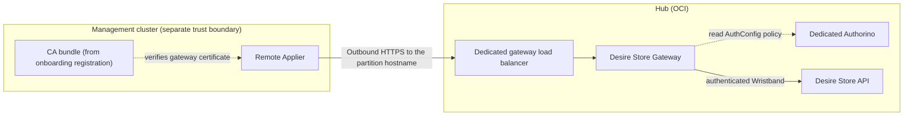
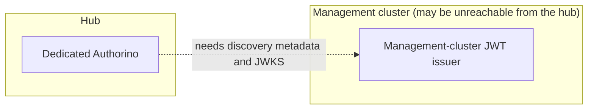

# SPIKE: Private Desire Store Gateway Connectivity and TLS Trust

**Jira**: [HYPERFLEET-1866](https://redhat.atlassian.net/browse/HYPERFLEET-1866)

## Table of Contents

- [Overview](#overview)
- [Topology and Trust Boundaries](#topology-and-trust-boundaries)
- [Options Evaluated](#options-evaluated)
- [Recommendation](#recommendation)
- [Recommended Approach](#recommended-approach)
  - [Hostname and DNS Resolution](#hostname-and-dns-resolution)
  - [Server-Identity Verification](#server-identity-verification)
  - [Trust Bootstrap](#trust-bootstrap)
  - [CA Distribution and Rotation](#ca-distribution-and-rotation)
  - [Certificate Shape](#certificate-shape)
- [Reachability Model for Issuer Publication](#reachability-model-for-issuer-publication)
- [Diagrams](#diagrams)
- [Evidence](#evidence)
- [Unsupported Topologies](#unsupported-topologies)
- [Expected work](#expected-work)

## Overview

Remote Appliers are designed to use the [Desire Store API rather than direct Postgres access](spike-remote-applier-postgres-access.md). This spike evaluates how they reach the gateway and verify its TLS identity, including when no private path exists.

## Topology and Trust Boundaries

- **Hub:** Oracle Cloud Infrastructure (OCI) hosts the hub. Its [public entry](../adrs/0036-management-cluster-ingress-tls-termination.md) uses Envoy Gateway, the `oci.hypershell.app` public zone, and ExternalDNS. ADR-0036 requires an internal certificate authority (CA) for Desire Store.
- **Management clusters:** The design covers OCI and planned on-premises deployments, including [disconnected installs](../adrs/0019-package-hyperfleet-as-operator.md). The [planning workload](desire-store-api-postgres-spike.md#load-and-isolation) models 10,000 management-cluster partitions. No private DNS zone, peering, or customer connection is in place for this path.
- **Trust boundaries:** The hub and each management cluster are separate trust boundaries. The hub accepts only registered management-cluster token issuers; the Applier relies on the CA bundle supplied at onboarding to verify the gateway. This does not require provisioning a shared secret across those boundaries.

## Options Evaluated

| Option | Reachability prerequisite | Scaling and security trade-off |
|--------|---------------------------|-------------------------------|
| Public hub entry | Outbound HTTPS from OCI or on premises; no private path required. | Reuses the existing entry architecture, one controller and public zone, without per-cluster network state; the gateway gets its own load balancer under that controller. The edge is public and requires fail-closed authentication and client TLS verification. |
| OCI peering and private DNS | A peered virtual cloud network (VCN) or VCN share, routes, and private DNS for each cluster. On-premises sites still need a path into OCI. | Restricts reachability without changing authentication. VCNs need non-overlapping address ranges. Local peering connects two VCNs; hub-and-spoke uses a dynamic routing gateway (DRG), subject to attachment limits. |
| Customer VPN or FastConnect | A customer provisions a tunnel or circuit; it does not solve onboarding when no path is available. | Restricts reachability at a customer-owned boundary but requires deployment-specific network work. |
| Outbound-initiated tunnel | A hub relay and a tunnel client per management cluster; works in OCI and on premises without an existing private path. | Avoids a public gateway endpoint but adds an always-on relay to operate and trust. Tunnel count and relay capacity scale with the fleet. |

## Recommendation

Use a separate Desire Store Gateway on the hub's public entry by default, served by its own load balancer under the one Envoy Gateway controller. This reaches OCI and on-premises clusters without provisioning a private network or operating a relay. Public exposure requires fail-closed authentication under the [gateway trust contract](desire-store-dd.md#gateway-trust-contract), not just TLS.

Keep private connectivity as a deployment option, including an internal-only load balancer where a public endpoint is prohibited. [ADR-0039](../adrs/0039-desire-store-gateway-reachability-tls-trust.md) records the exposure and trust requirements.

## Recommended Approach

### Hostname and DNS Resolution

- **Hostnames:** Remote Appliers use partition hostnames such as `mc-01.desire-store.oci.hypershell.app`. Fleet-scoped callers (Adapter and sweeper) use the base hostname in-cluster. The names matter because Authorino selects the authentication policy by request hostname.
- **Public DNS:** One wildcard record covers all partition hostnames. The proposed split is Terraform for the wildcard and the existing ExternalDNS Service integration for the base record; fleet-scoped callers do not depend on that base record being public.
- **Private DNS:** The deployment's resolver points the same hostnames at its private endpoint, so the gateway certificate and client hostname checks do not change.

### Server-Identity Verification

The Applier validates the certificate chain against the onboarding bundle and matches the requested hostname against a certificate subject alternative name (SAN). Both checks are required; [the probe below](#evidence) exercised them separately.

### Trust Bootstrap

- **Use authenticated onboarding:** The operator delivers the bundle from the registration record. The same handoff works for connected and disconnected installs.
- **Do not add a public bundle endpoint:** Fetching from a publicly trusted endpoint could automate refresh for connected installs but adds a second mechanism that cannot replace the disconnected handoff.

### CA Distribution and Rotation

- **Separate the gateway CA from the hub root:** Reuse the chart's cert-manager issuance pattern, not its root. The existing root has automatic renewal disabled and signs hub-internal Authorino and API service certificates. Distributing it would extend remote trust to those services and couple remote bundle rotation to hub-internal CA rotation.
- **Coordinate bundle rollout with certificate cutover:** The [ADR's rollover contract](../adrs/0039-desire-store-gateway-reachability-tls-trust.md#mechanics) defines when the operator distributes the bundle, when the Applier must reload it, when the gateway can switch certificates, and when the old root is retired. The rotation trigger and cadence are not fixed by the contract and remain to be decided.

### Certificate Shape

- **Use one certificate per served zone:** Include both the base hostname and the partition wildcard. The wildcard alone does not cover the base hostname.
- **Per-partition certificates do not scale:** [Gateway API](https://github.com/kubernetes-sigs/gateway-api/blob/main/apis/v1/gateway_types.go) defines one Secret reference per listener as Core; multiple certificate references are implementation-specific. It caps certificate references at 64 per listener and listeners at 64 per Gateway. At 10,000 partitions, dedicated certificates would require 10,000 issuances and Secrets plus additional listeners and Gateways, even with multi-certificate support.
- **Match revocation to the compromised identity:** A shared certificate represents the gateway, not a partition. Partition credential compromise is handled by the [detailed design's revocation rules](desire-store-dd.md#token-lifetime-and-revocation-behavior). A compromised gateway key requires replacing the serving certificate.

## Reachability Model for Issuer Publication

- **Data path:** The Applier initiates HTTPS to the gateway for desire reads and status writes. That connection requires no reverse network path.
- **Trust path:** Authorino needs the registered issuer's discovery metadata and JSON Web Key Set (JWKS). It cannot assume direct access to an on-premises issuer behind a firewall or an OCI issuer in an unpeered network. [HYPERFLEET-1834](https://redhat.atlassian.net/browse/HYPERFLEET-1834) owns how those materials are made reachable without requiring a hub-initiated connection into the management cluster at request time.

## Diagrams

Applier-to-gateway connectivity (public data path):

Issuer discovery (trust path). The dashed dependency does not represent a direct connection into the management cluster:

## Evidence

- **Prior proof of concept:** ADR-0036 and [HYPERFLEET-1909](https://redhat.atlassian.net/browse/HYPERFLEET-1909) demonstrated TLS on the public entry, certificate issuance, and listener-scoped fail-closed authorization with header stripping. That evidence does not validate the proposed Desire Store route end to end.
- **This spike, TLS only:** A scratch Gateway on the proof-of-concept cluster served a dedicated internal-CA certificate with both the base and wildcard SANs. The client connected directly to the load balancer.
  - **Verified:** The client trusted the chain and matched two partition hostnames using the extracted bundle. HTTP 404 was expected because no route was attached.
  - **Rejected:** Without the bundle, certificate-chain verification failed. With the bundle but a hostname outside the SANs, hostname verification failed.
  - **Not exercised:** Production DNS, onboarding delivery, and authenticated routing.
- **Source inspection, not runtime evidence:** The upstream [ExternalDNS OCI provider](https://github.com/kubernetes-sigs/external-dns/blob/master/provider/oci/oci.go) selects zones by configured scope and lists all scopes if unset; the deployed version's parity is unverified.
- **Paper assessment only:** No live OCI peering or on-premises private path was tested, and the available DRG attachment quota is unconfirmed.

## Unsupported Topologies

A fully isolated cluster cannot use the gateway. It needs an HTTPS path to the hub, whether direct, through a proxy, or over a private connection. Onboarding supplies trust, not connectivity.

## Expected work

Implementation and validation are tracked under the [Desire Store epic](https://redhat.atlassian.net/browse/HYPERFLEET-1518):

- **Gateway serving:** Gateway, certificate, and DNS integration, including verifying the deployed ExternalDNS matches the inspected zone-scope behavior.
- **Trust distribution:** Onboarding handoff, client reload, and CA rollover operations: the rotation trigger and cadence decision, and alerting for stale bundles.
- **Validation:** End-to-end verification of the flows not exercised by the TLS probe, including private connectivity and the DRG attachment quota where a topology exists.
